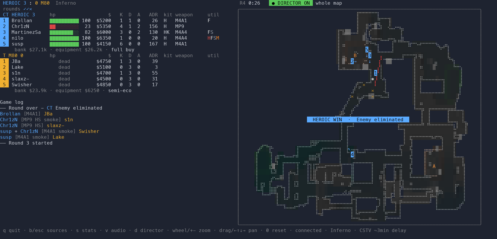
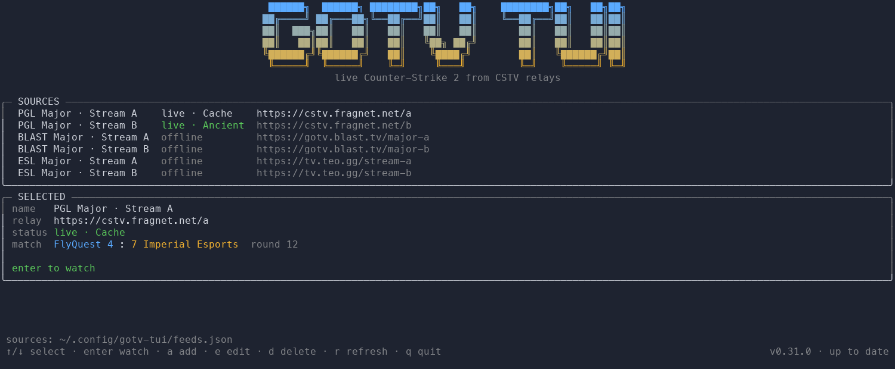

# gotv-tui

[](https://github.com/dormonbear/gotv-tui/releases/latest)
[](https://github.com/dormonbear/gotv-tui/actions/workflows/ci.yml)
[](go.mod)

**Watch live Counter-Strike 2 matches in your terminal.** gotv-tui reads the public
CSTV (GOTV+) broadcast that tournament organizers publish for in-game viewing and
shows the scoreboard, the game log and a live radar with every player on it.

No game client, no account, no scraping: one ~4 MB binary for macOS, Linux and Windows.



<sub>HEROIC vs M80 at the PGL Major Singapore 2026, in a terminal without image support
(braille map). Terminals like Ghostty, kitty, iTerm2 or WezTerm show the real radar image.</sub>



## Features

- **Live radar** with every player, their facing, the bomb, smokes, molotovs,
  grenades in flight, kill lines, kill and headshot effects, and the C4 explosion.
  Two-level maps (Nuke, Train, Vertigo) show both levels side by side or stacked.
- **Real map images** in terminals that support them (kitty, Ghostty, iTerm2,
  WezTerm, Windows Terminal, ...), braille outlines everywhere else.
- **Zoom and pan** with the mouse wheel and drag, pixel-smooth in kitty/Ghostty.
- **Auto director**: the camera follows the fights, cuts to kills just before they
  happen (it plays back from a short buffer, so it knows what's coming), and follows
  the bomb after the plant.
- **Follow a player**: click them on the map or the scoreboard.
- **Scoreboard**: HP, money, K/D/A, ADR, armor and kit, weapon and grenades, and the
  round clock with bomb and defuse timers; press `s` for match stats (HS%, KAST%,
  KPR, utility damage, enemies flashed, multi-kills). Team economy and round history.
- **Game log**: kills with assists, flash assists, headshots, wallbangs and
  through-smoke kills; plants, defuses and round results.
- **Source list** of relays with live status and who is playing, refreshed every 30 s.
- **Adapts to the window**: side by side on a wide terminal, stacked on a narrow one
  or a phone, with a compact scoreboard when space is tight.
- **Listen along**: play a stream's audio (the official broadcast or a co-streamer)
  and line it up with the radar; tap `t` when the commentary calls a kill.
- **Record and replay** a match: `gotv-tui record <url>`, `gotv-tui replay <dir>`.
- **Play demo files** (`.dem`), at any speed: `gotv-tui demo <file> [x]`.
- **Self-updating**: `gotv-tui update`.

## Install

**macOS / Linux**

```sh
curl -fsSL https://raw.githubusercontent.com/dormonbear/gotv-tui/main/install.sh | sh
```

The script picks the binary for your OS and CPU, checks it against the release's
`SHA256SUMS`, and installs it to `~/.local/bin` (set `GOTV_TUI_INSTALL_DIR` to change).
Every release asset also carries a GitHub build provenance attestation; to check one
was built by this repository's CI: `gh attestation verify gotv-tui-darwin-arm64.gz --repo dormonbear/gotv-tui`.

**Windows**

Download `gotv-tui-windows-x64.exe` from the
[latest release](https://github.com/dormonbear/gotv-tui/releases/latest) and run it.
Use Windows Terminal for the real map image; started from the old console, gotv-tui
reopens itself in Windows Terminal when it is installed.

**With Go** (1.27+)

```sh
go install github.com/dormonbear/gotv-tui@latest
```

**Update**

```sh
gotv-tui update
```

## Usage

```sh
gotv-tui                                  # pick a relay from the source list
gotv-tui https://cstv.fragnet.net/a       # open a relay directly
gotv-tui 'playcast "https://cstv.fragnet.net/a"'   # pasted as published
gotv-tui record https://cstv.fragnet.net/a   # watch and save to ./gotv-<time>/
gotv-tui replay gotv-20261125-190000        # watch a saved match later
gotv-tui demo match.dem 4                   # play a demo file, here at 4x speed
gotv-tui --version
```

A recording is the relay's own fragments plus when each arrived, so a replay plays
at the broadcast's pace and looks exactly like the live match (handy for matches you
missed, or for developing without a live game).

### Finding a relay

Organizers publish CSTV addresses for community casters and in-game viewers, usually
as a console command such as `playcast "https://..."` on the event page, in their
co-streaming / community broadcast guidelines, or in their Discord. Paste the whole
line (or just the URL) into the source list with `a`, or pass it on the command line.

Public relays are, in practice, a Major thing: Valve has organizers open CSTV for
Majors, while most other events keep it closed or hand it out per match on
FACEIT/Challengermode. The list starts with the relays used by recent Major organizers
(PGL, BLAST, ESL); they come back to life when that organizer runs the next Major,
whose relays are usually announced about two weeks ahead in its community broadcast
guidelines. A relay shows as:

| Status | Meaning |
|---|---|
| `live` | a match is being broadcast; the row shows the teams, score and round |
| `stale` | the last match is over, nothing new yet |
| `waiting for broadcast` | the relay is up and waiting for the next match |
| `offline` | the relay doesn't answer |

**The broadcast runs about 3 minutes behind the live match**; the organizer sets that
delay, not gotv-tui.

### Keys

**Source list**

| Key | Action |
|---|---|
| `↑` `↓` / `k` `j` | select |
| `enter` | open |
| `a` / `e` / `d` | add / edit / delete a source |
| `r` | refresh now (also automatic every 30 s) |
| `q` | quit |

**Match**

| Key / mouse | Action |
|---|---|
| wheel, `+` `-` | zoom (around the pointer) |
| drag, `←↑↓→`, `hjkl` | pan |
| `0` | whole map |
| `d`, click the switch | auto director on/off (on by default) |
| `v` | audio: pick a platform (Huya, Twitch, Bilibili, a URL, or Off), then type the room or channel; e.g. Huya `123321`, Twitch `eslcs`; `↑`/`↓` bring back rooms that played before. Leaving a source and coming back resumes its audio (not after a restart). Twitch needs `HTTPS_PROXY` where it's blocked |
| `[` `]` / `{` `}` | audio sync: shift by 1 s / 0.1 s |
| `a` | audio auto sync on/off (reads the stream's round clock) |
| `t` | audio sync: press as a kill is called; lines up on the nearest kill |
| `s` | scoreboard: live state ↔ match stats (+/-, ADR, HS%, KAST% (trades counted from when you connect), KPR, utility damage, enemies flashed, 3k/4k/5k) |
| `1`–`5`, `6`–`0` | follow CT player 1–5 / T player 1–5 (their badge number); the same key again stops |
| click a player | follow them (on the map or the scoreboard); click again or elsewhere to stop |
| `?` | all keys; any key closes it |
| `b`, `esc` | back to the source list |
| `q`, `ctrl+c` | quit |

Any manual zoom or pan hands the camera back to you.

## Listening along

`v` plays a live stream's sound next to the radar (no video): the official broadcast
on Twitch or YouTube, a co-streamer on Huya or Bilibili, or any direct media URL (`.flv` /
`.m3u8`, e.g. copied from the browser's network panel while the stream plays). It needs [yt-dlp](https://github.com/yt-dlp/yt-dlp) and
[FFmpeg](https://ffmpeg.org) on your PATH (`brew install yt-dlp ffmpeg`).

Streams and CSTV run on different delays. **Auto sync** (on by default, `a` toggles it)
lines them up by itself: it reads the round clock off the stream's picture (key frames
only) and finds when the match data showed the same second. A clock value comes back
every round, so it settles once reads from two rounds agree, and keeps re-checking as
the match goes on. Nothing extra to install: the digits are recognised in-process,
then learned from the stream's own font within seconds. It needs a stream showing the
broadcast HUD and is accurate to about a second. The offset found is remembered per relay and stream
(`~/.config/gotv-tui/offsets.json`), so reopening the same pair starts lined up.
When the offset changes, the sound received over the last ten minutes is kept, so
the audio jumps straight to the right moment (replaying a stretch if it has to go
later) instead of going quiet. Click the audio badge above the map to mute it; it
comes back lined up. To fine-tune, or for streams without
the HUD, press `t` the moment the
commentary calls a kill, and gotv-tui shifts by the gap to the nearest kill (one it
has shown, or one about to show); repeat to refine, or nudge with `[` `]` (1 s) and
`{` `}` (0.1 s). If the audio is later than the match data the radar waits for it;
if it is earlier, the audio is held back.

Douyu and Douyin live aren't supported by name: their stream links need signing
that yt-dlp currently can't do. A media URL copied from the browser works. (Huya
addresses are re-signed by gotv-tui, as yt-dlp's stop after a second.)

## Terminal support

The radar is drawn as a real image where the terminal can show one:

| Terminal | Map |
|---|---|
| Ghostty, kitty | kitty graphics: uploaded once, markers as sprites, pixel-smooth zoom and drag |
| iTerm2, WezTerm | iTerm2 inline images, whole frame, up to 10 fps |
| Windows Terminal (1.22+), foot, Konsole | Sixel, whole frame, up to 10 fps |
| VS Code | set `terminal.integrated.enableImages` and run with `GOTV_TUI_GRAPHICS=iterm` |
| Terminal.app, Alacritty, others | braille outlines; more detail appears as you zoom in |

Started in Terminal.app (for example by a double-click on macOS) or the old Windows
console, gotv-tui reopens itself in the best installed terminal: Ghostty, kitty,
WezTerm or iTerm2 on macOS, Windows Terminal on Windows.

## Configuration

| Environment variable | Effect |
|---|---|
| `GOTV_TUI_GRAPHICS` | `kitty`, `iterm`, `sixel` or `off`: force the map renderer |
| `GOTV_TUI_RELAUNCH=0` | stay in the current terminal instead of reopening in a better one |
| `GOTV_TUI_CELL_ASPECT` | terminal cell height / width (e.g. `2.1`) if the map looks stretched; normally measured |
| `GOTV_TUI_INSTALL_DIR` | where `install.sh` puts the binary |

| File | Contents |
|---|---|
| `~/.config/gotv-tui/feeds.json` | your source list |
| `~/.config/gotv-tui/audio.json` | audio rooms that played, per platform |
| `~/.cache/gotv-tui/radar/` | downloaded radar images |

## FAQ

**Why is it 3 minutes behind?**
CSTV broadcasts are delayed by the organizer to stop ghosting. Every viewer of the
relay, in game or here, sees the same delay.

**The list says `offline` / `waiting` at match time.**
Between matches a relay answers "waiting" until the first fragment of the next match
arrives, usually a minute or two after it starts. Relays are also only up around
their event; outside it they are `offline` or `stale`.

**The map is a blurry outline, not an image.**
Your terminal doesn't support an image protocol, or gotv-tui didn't detect it. See
[Terminal support](#terminal-support); you can force one with `GOTV_TUI_GRAPHICS`.
Inside tmux, images need `set -g allow-passthrough on` and a supporting outer terminal.

**The map looks stretched.**
Set `GOTV_TUI_CELL_ASPECT` to your font's cell height divided by its width.

## How it works

```
CSTV relay (HTTP fragments, 1/s)
  → demoinfocs-golang parser          internal/gotv
  → 4 s playback buffer, 16 fps       internal/playback
  → director (looks ahead in the buffer)   internal/director
  → radar + scoreboard + log          internal/radar, internal/ui (Bubble Tea)
```

Radar images and calibration are Valve's overview files, fetched on first use from
[2mlml/cs2-radar-images](https://github.com/2mlml/cs2-radar-images).

## Contributing

Bug reports, relay URLs for other events and pull requests are welcome; see
[CONTRIBUTING.md](CONTRIBUTING.md). `main` releases automatically on merge.

## Acknowledgements

- [demoinfocs-golang](https://github.com/markus-wa/demoinfocs-golang): CS2 demo and CSTV broadcast parsing
- [Bubble Tea](https://github.com/charmbracelet/bubbletea) and [Lip Gloss](https://github.com/charmbracelet/lipgloss): the TUI
- [2mlml/cs2-radar-images](https://github.com/2mlml/cs2-radar-images): radar images; maps it lacks (Cache) from [MurkyYT/cs2-map-icons](https://github.com/MurkyYT/cs2-map-icons) with overviews from [SteamTracking/GameTracking-CS2](https://github.com/SteamTracking/GameTracking-CS2)
- Valve's HLTV director, whose look-ahead shot selection the auto director follows

## Disclaimer

gotv-tui is an unofficial fan project, not affiliated with or endorsed by Valve,
HLTV or any tournament organizer. Counter-Strike is a trademark of Valve Corporation.
It only reads broadcasts that organizers publish for public viewing.

## License

[GPL-3.0](LICENSE). Releases up to v0.35.0 were MIT. Radar images are Valve's and
are downloaded at run time, not shipped.
